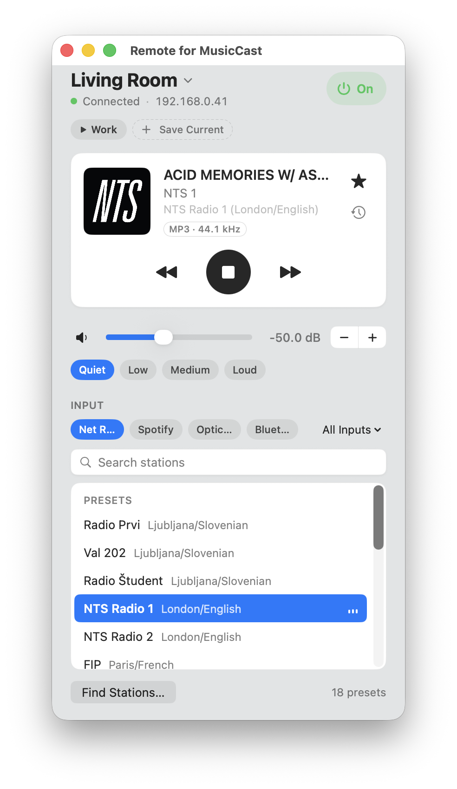
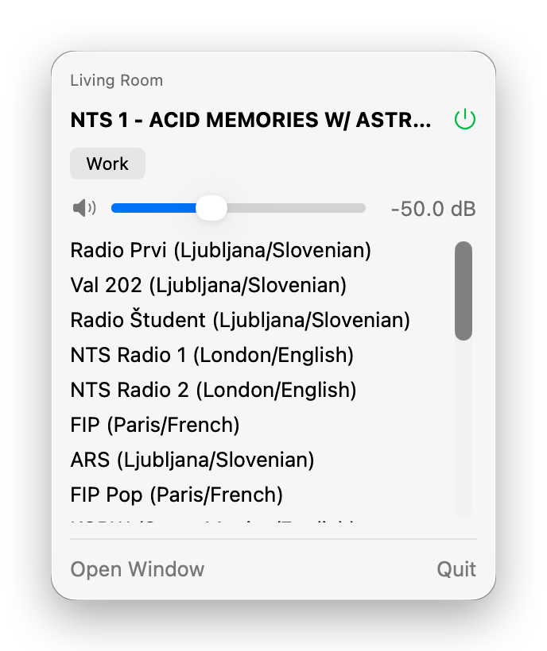

# Remote for MusicCast

A small macOS app for controlling a Yamaha MusicCast receiver over the local network, using Yamaha Extended Control (YXC). Built and tested with an R-N602.

<p align="center">
  
  &nbsp;&nbsp;
  
</p>

- Power, volume in dB (slider, typed value, or Quiet / Low / Medium / Loud presets), mute
- Inputs, net radio and tuner presets, internet radio search
- Now playing with artwork and the incoming audio format
- Song history for net radio
- Routines: one click turns the receiver on, plays a preset and sets the volume
- A menu bar extra that keeps working with the window closed

## Requirements

- macOS 13 Ventura or later
- Xcode Command Line Tools with Swift 5.9 or later. Full Xcode isn't needed. Install the tools with:

  ```sh
  xcode-select --install
  ```

- A Yamaha MusicCast receiver on the same network as the Mac

## Build

```sh
git clone https://github.com/azagsam/musiccast-remote.git
cd musiccast-remote
./build.sh
```

This builds a release binary with `swift build` and packages it as `build/Remote for MusicCast.app`, signed ad hoc for local use.

## Install

Copy the app into Applications and open it:

```sh
cp -R "build/Remote for MusicCast.app" /Applications/
open "/Applications/Remote for MusicCast.app"
```

On first launch:

- **Local network access:** macOS asks whether Remote for MusicCast may find devices on your local network. Choose **Allow**, or the app can't reach the receiver. If you declined, turn it on in System Settings ▸ Privacy & Security ▸ Local Network.
- **Gatekeeper:** the app is signed ad hoc, not notarized. A copy you built yourself opens normally. A copy downloaded from elsewhere may be blocked; right-click it and choose **Open**, or allow it in System Settings ▸ Privacy & Security.

The app looks for receivers with SSDP when it starts. If it doesn't find yours, click the receiver name at the top of the window and enter its IP address.

To start the app at login, add it in System Settings ▸ General ▸ Login Items.

## Update

```sh
git pull
./build.sh
cp -R "build/Remote for MusicCast.app" /Applications/
```

Quit the running app before copying, then open it again.

## Command line checks

The binary has two options that don't open the UI:

```sh
"build/Remote for MusicCast.app/Contents/MacOS/MusicCastRemote" --discover   # list receivers on the network
"build/Remote for MusicCast.app/Contents/MacOS/MusicCastRemote" --check      # print status, presets and a test search
```

`--check` doesn't change playback or presets, but it does browse the receiver's radio menu.

## Data

Settings are kept in the app's user defaults (`io.github.azagsam.MusicCastRemote`). The song history and routines are in `~/Library/Application Support/Remote for MusicCast/`.
Settings and data from versions named Yamaha Remote are copied over on first launch.

## License

[MIT](LICENSE)

## Trademarks

This is an independent project, not affiliated with, endorsed by or sponsored by Yamaha Corporation. Yamaha and MusicCast are trademarks of Yamaha Corporation, used here only to describe which devices the app works with.
